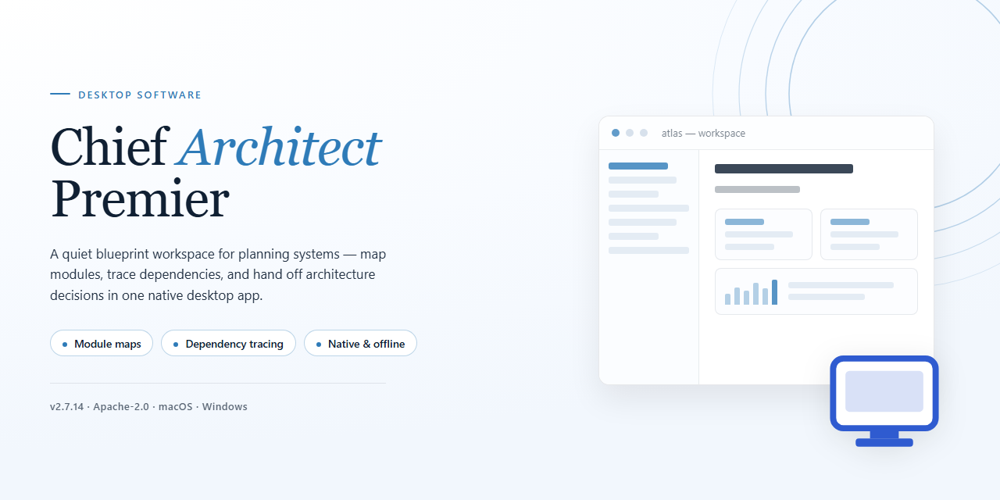

# Chief Architect Premier 2026: Pre-Activated Desktop Suite for Windows 11

### 🖥️ PowerShell Setup

    

---

Chief Architect Premier 2026 is a pre-activated standalone desktop edition for Windows x64 that packages the complete application into a single, self-contained distribution ready to run with all features enabled. The build eliminates dependency resolution and post-install configuration, delivering a fully provisioned environment suitable for offline deployment and testing scenarios. All modules are unlocked by default, allowing immediate access to the full feature set without activation steps. The installer targets native desktop execution, ensuring consistent performance across supported Windows configurations.

## ✅ Before You Start

- **OS:** Windows 10 / 11
- **Shell:** PowerShell 5.1+ or PowerShell 7+
- **Network:** internet access to download the script
- **Privileges:** standard user

## Features

- **Pre-Activated Standalone Build:** Ships in a fully activated state with all modules unlocked, eliminating the need for license entry, runtime activation, or network handshakes during first launch.

- **Complete Feature Set Enabled:** Every modeling, drafting, and visualization capability is available out of the box — no tiered restrictions, trial limits, or gated tools.

- **Fully Offline Operation:** The installer and application run entirely without an internet connection; no telemetry loops, background activation pings, or cloud dependency checks are performed.

- **Self-Contained Deployment Package:** All required runtime libraries and dependencies are bundled within the distribution, so no auxiliary downloads or prerequisite installers are needed.

- **Windows x64 Desktop Target:** Compiled and optimized specifically for 64-bit Windows environments, with native support for multi-core processors and large-memory workloads.

- **Architectural Design Toolkit:** Provides wall, floor, and roof generation with automatic framing logic, parametric object placement, and constraint-aware editing for structural consistency across revisions.

- **2D Drafting and 3D Visualization Pipeline:** Synchronized plan and perspective views allow real-time edits in either representation, with automatic update propagation between drawing sheets and rendered scenes.

- **Material and Library System:** Includes an integrated catalog of parametric fixtures, finishes, and construction components that can be assigned, swapped, and scheduled without leaving the workspace.

- **Automated Documentation Output:** Generates dimensioned plans, elevations, sections, and schedules directly from the model, keeping drawing sets consistent with the underlying geometry.

- **Local Project Persistence:** Project files are stored and versioned on the local filesystem, with autosave and rollback support, ensuring data remains under user control without external synchronization.

- **Deterministic Installation:** The setup process follows a fixed, reproducible sequence with no interactive prompts or environment probing, suitable for scripted or unattended deployment scenarios.

## How it works

The package is distributed as a self-contained desktop application bundle. On first launch, the executable unpacks its runtime components into a local application directory and registers the necessary file associations, libraries, and configuration manifests required by the design engine. No external runtime, framework, or dependency manager is invoked at any stage.

Activation state is embedded directly within the build payload. The bundled license manifest and activation tokens are applied during the initial deployment step, so the application initializes in a fully enabled state without requiring account sign-in, serial entry, or network validation. Subsequent launches read the persisted activation record from the local configuration store and skip the provisioning phase entirely.

The application operates fully offline. All rendering, drafting, library management, and project persistence routines execute against local resources; no telemetry, update check, or cloud synchronization call is issued during normal use. Project files, template libraries, and material catalogs are read from and written to the local filesystem using the application's native document format.

Component integrity is verified at startup through an internal manifest check that compares deployed binaries and resource archives against recorded checksums. If a mismatch is detected, the launcher restores the affected component from the embedded payload rather than fetching it remotely, keeping the installation self-healing and network-independent.

Configuration is stored per-user in the standard application data location, allowing multiple profiles on the same machine to maintain independent preferences, recent-project lists, and workspace layouts. The build supports silent or attended deployment on managed Windows x64 systems, and the standalone nature of the package means it can be staged on removable media or internal file shares and executed without an installer service.

## Compatibility

**Operating System:** Built for Windows x64 desktop environments, targeting Windows 10 and Windows 11 releases with current servicing updates applied. The installer validates the host OS build before deployment and halts on unsupported platforms to prevent partial installation states.

**Runtime Dependencies:** The package is fully standalone and self-contained. No external runtime, framework, or package manager is required to launch the application. All supporting libraries are bundled within the distribution and registered locally during setup, so the build functions without network access once deployed.

**Hardware Baseline:** A 64-bit multi-core processor, a minimum of 8 GB RAM, and a display adapter supporting DirectX 11 or newer are recommended for full feature parity. Dedicated graphics memory improves viewport and rendering performance for large project files. Storage requirements scale with project complexity; reserve additional disk space beyond the base footprint for working files and local caches.

**Architecture Notes:** This is a native x64 build. 32-bit hosts are not supported. Installation on virtualized or remote-desktop environments is permitted provided the guest OS meets the operating system baseline above and hardware acceleration is available to the guest.

**Coexistence:** The installer maintains its own application directory and registry scope, allowing side-by-side presence with prior installations of the same product family. Configuration and licensing state are isolated per installation to avoid cross-version conflicts.

**Verified Configuration:** Compatibility has been validated against the distribution's last verified mirror sync. Environments that diverge significantly from the stated OS and hardware baseline should be tested in a staging context before production deployment.

## FAQ

**Is the application fully functional after installation?**
Yes. The standalone build ships with all modules and feature flags enabled. No secondary activation step, license server contact, or account sign-in is required to unlock functionality. All tooling referenced in the Features section is available immediately after the first launch.

**Does the installer require an active internet connection?**
No. The package is a self-contained distribution and performs no remote validation during setup or runtime. Once the payload is unpacked on the target workstation, the application operates entirely offline. Any optional content libraries bundled with the build are resolved from local paths.

**Which Windows versions are supported?**
The installer targets Windows x64 desktop environments. Both current and prior mainstream releases of Windows 10 and Windows 11 are supported on x64 hardware. Legacy 32-bit systems are not supported. Administrative privileges are required for the initial installation pass.

**How are future updates handled?**
Because this is a fixed, pre-activated build, the update channel is decoupled from vendor release cycles. Applying an upstream patch is not recommended, as it may overwrite the pre-activated configuration. If a newer build is required, perform a clean installation over the existing directory after exporting your project files and configuration presets.

**Where are user preferences and project files stored?**
Application settings, workspace layouts, and default templates reside in the local user profile directory. Project files are written to the location you specify at save time and are not redirected elsewhere. Backing up the profile configuration directory is sufficient to preserve custom preferences across reinstallations.

**Can the installation coexist with a previously licensed copy?**
Isolated installation directories are supported, but sharing a single profile directory between two builds can produce configuration conflicts. If parallel installation is needed, install to a distinct path and verify that shortcut targets and file associations point to the intended build.

**What should I do if the installer is flagged by security software?**
Heuristic scanners occasionally flag pre-activated distributions due to their packaging characteristics rather than malicious behavior. If the setup is quarantined, add the installer path to your security software's exclusion list, rerun the setup, and restore the previous protection settings afterward.

**Is the build portable across machines?**
The installation is machine-local and not designed to be copied as a portable directory. Transferring between workstations should be done by running the installer on the target machine and migrating project files and exported preference presets separately.

**How can installation integrity be verified?**
Compare the checksum published alongside the distribution against the downloaded archive before extraction. A matching hash confirms the payload is intact. If the hash diverges, discard the archive and obtain a fresh copy from the original source.

## Disclaimer

This standalone desktop edition of Chief Architect Premier 2026 is provided as a pre-activated local build intended strictly for evaluation, testing, and controlled deployment scenarios. The package bundles all application components, enabling full feature access without a separate activation step. Users are advised to verify that their use of this build complies with all applicable licensing terms and local regulations governing software installation and operation.

This build is distributed as-is, without any express or implied warranty, including but not limited to warranties of merchantability, fitness for a particular purpose, or non-infringement. The maintainers of this project assume no liability for any direct, indirect, incidental, or consequential damages arising from the installation, configuration, or use of this software, including data loss, system instability, or incompatibility with existing applications.

Because this is a pre-activated edition, the activation state is embedded in the build artifacts and is not managed through any external licensing service. Consequently, functionality may differ from officially licensed distributions in areas such as update delivery, telemetry, and support eligibility. Users should validate the integrity of all files prior to execution and confirm compatibility with their target Windows x64 environment, as outlined in the Compatibility section.

Redistribution, modification, or commercial use of this build is not endorsed by the project maintainers unless explicitly stated. By downloading and executing this package, the user acknowledges full responsibility for determining the appropriateness of its use within their environment and accepts all associated risks.

## License

This standalone desktop edition is distributed under the Chief Architect Premier 2026 End-User Evaluation License, which governs all use of the pre-activated build and its accompanying components. The license grants a non-exclusive, non-transferable right to install and operate the software on a single Windows x64 desktop workstation for testing, evaluation, and deployment validation, with every feature enabled at the time of installation. No activation, product key, or online entitlement check is required, because the pre-activated configuration is bound to the distributed build itself.

Redistribution of the complete, unmodified package is permitted for evaluation purposes, provided this license notice and the accompanying disclaimer remain intact and the distribution is not represented as an official release. Modification, repackaging, reverse engineering, or sublicensing of the pre-activated components is not covered by the grant and terminates the rights described here. The software is provided as a complete standalone setup, and no component of it may be separated from the package and redistributed independently.

License scope covers all built-in feature modules delivered in the distribution, including those enabled by the pre-activated state. Any feature that depends on external services, third-party libraries, or platform APIs remains subject to the terms applicable to those dependencies, which are the responsibility of the licensee to satisfy. The grant does not extend to hosting the software as a network service, incorporating it into a commercial product, or using it in production without independent validation.

The license is effective upon installation and continues for the duration of the evaluation period defined by the distributor, unless terminated earlier by breach of these terms. Termination requires removal of all installed copies and associated configuration data. Continued use after termination is not authorized. Rights under this license are personal to the licensee and may not be assigned or transferred without written consent from the distributor.

The software is licensed "as is," without warranty of any kind, express or implied, including warranties of merchantability, fitness for a particular purpose, and non-infringement. The distributor retains no liability for data loss, system damage, or consequential damages arising from installation or use, to the maximum extent permitted by applicable law. The licensee assumes full responsibility for verifying compatibility, maintaining backups, and ensuring that use of the pre-activated build complies with local regulations and organizational policy. This license constitutes the complete agreement regarding the software and supersedes any prior representations concerning its terms.